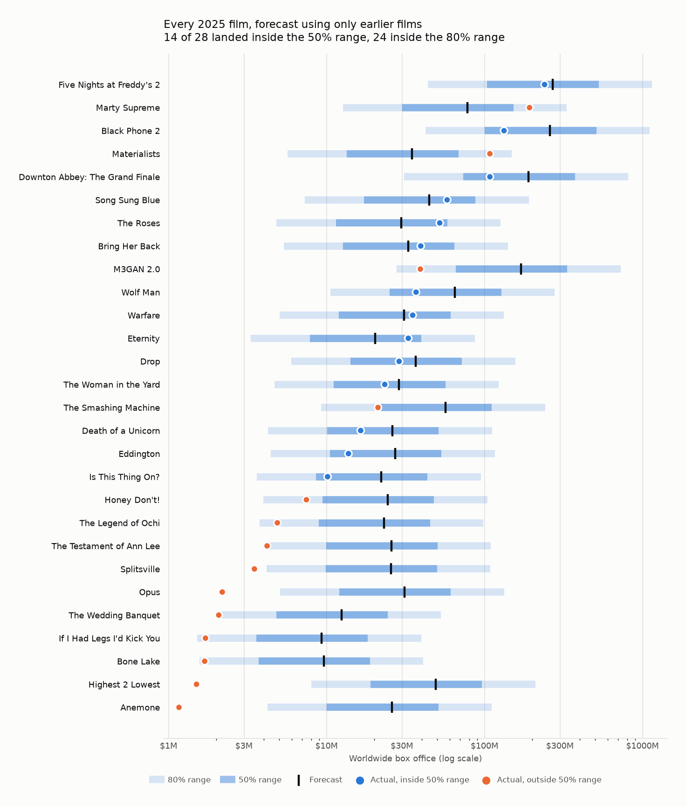
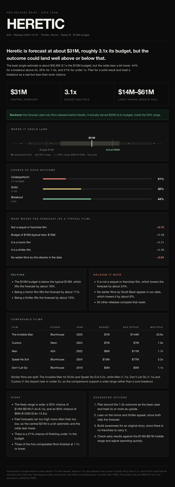

# Indie Film Forecaster

**Try it:** [indie-film-forecaster.streamlit.app](https://indie-film-forecaster.streamlit.app) (private, access on request)

How far can you get forecasting an indie film's box office with only public data? And can an AI agent turn that forecast into something a marketing team would actually read?

You give it a film's details before release: budget, genre, rating, release date, director and so on. It gives you:

- a central box office forecast
- a range that has been checked against reality
- the odds of underperforming, doing fine or breaking out
- what is pushing the forecast up or down
- the five most similar past films

Then Claude writes a one-page brief from that, in plain English, for a marketing team.



*Every 2025 release in the data, forecast using only films released before 2025. The bars are the 50% and 80% ranges, the black tick is the forecast and the dot is what the film actually earned.*

## Results

*All numbers in this README come from data pulled from TMDB on 12 November 2026. The live app downloads fresh data, so its figures can differ slightly.*

I tested it the way it would actually be used. For each year from 2019 to 2025, the model learned only from films released before that year, then forecast that year's films. That gives 101 test films it had never seen. I left 2020 and 2021 out as test years because theaters were closed or half empty, but those films are still used for training.

| Method | Typical error |
|---|---|
| Simple rule (budget times the usual multiple) | 2.51x |
| Linear model | **2.22x** |
| Gradient boosting | 2.42x |

**Are the ranges honest?** The range comes from how far off the forecasts were on films the model hadn't seen, not from how well it fits its own training data. Tested the same way:

- the **50% range** contained the real result for **44%** of films
- the **80% range** contained it for **78%**

So when it says "probably between $14M and $61M", that's roughly what it means.

**Are the odds honest?** The odds of each outcome (under 1x, 1–3x, over 3x budget) come from the same past misses as the range. I first used a separate classifier for this. It picked the right outcome 44% of the time, but its probabilities were no better than quoting base rates (Brier score 0.712 vs 0.710, lower is better), and when it said "80%+ likely" it was right only 58% of the time. Building the odds from the tested error spread scores 0.645, and keeps the odds consistent with the range.

**Where it goes wrong:** almost all the big misses are tiny releases that made under $5M, like *Highest 2 Lowest* (mostly streaming) or *Anemone*. Excluding those, the 50% range held 52% of the time. The public data can't tell a wide release from a small one before it opens, and that's exactly what a studio's own release plan would fix (see below).

### Three examples

- **Heretic (A24, 2024).** Using only earlier films: about $31M, probably $14M–$61M. It made $52M, inside the range.
- **M3GAN 2.0 (Blumhouse, 2025), a miss.** It forecast about $174M, probably $67M–$342M, because sequels to breakouts usually do well. It made $39M. Franchise fatigue isn't in public data.
- **Behemoth! (Searchlight, December 2026).** Not out yet. Central forecast about $42M, probably $13M–$73M. The odds lean lower than that number (56% chance of earning under its $36M budget), because past forecasts were more often too high than too low. We'll see.

I tested shifting the central forecast down to correct for that lean. It made the forecasts less accurate (2.39x vs 2.22x), because the lean comes mostly from a few tiny releases, so the single number stays as it is and the odds carry the caution.

Here is the brief for Heretic, made using only films released before it. Claude wrote the text without knowing the real result; every number and chart comes from Python:



The briefs for all three films are in [`output/`](output) (download an `.html` file and open it in a browser).

## How it works

```
fetch_films.py  →  films.csv  →  forecaster.py  →  predict.py / app.py  →  brief.py
   (TMDB)                       (features, models,       (one film)         (Claude writes
                                 honest ranges)                              the words)
```

1. **`fetch_films.py`** pulls about 435 films from 2012 to 2026 from TMDB. They come from A24 and studios that make similar films: Neon, Focus Features, Searchlight, Annapurna, Bleecker Street and Blumhouse. Responses are cached, and `films_meta.json` records when the data was pulled.
2. **`forecaster.py`** cleans the data and makes the forecast. It predicts how many times its budget a film will earn, using only things you'd know before release:
   - budget, in 2025 dollars
   - genre, rating, sequel or not, runtime and release month
   - how many films open the same week
   - the director's track record, from their earlier films only
3. **`evaluate.py`** runs the year-by-year test above and draws the chart.
4. **`brief.py`** sends the forecast to Claude and builds the one-page brief. Claude only writes the text, and its answer must match a fixed structure. Every number and chart comes from Python, so it can't get a figure wrong. For past films, the real result is hidden from Claude, so the brief is written blind.
5. **`app.py`** is a simple form, so anyone can get a forecast without touching code.

Two models, each for one job:

- A linear model (ridge regression) for the central forecast. The ranges and the odds come from its tested past errors.
- Nearest neighbours for the five closest past films (matched on budget, genre, rating and sequel status)

## Things I tried that didn't work

- **Star power**, meaning the past box office of the top three actors. It made no difference, and it wasn't significant (p = 0.45).
- **Keywords** like "supernatural horror" or "based on a true story". They looked significant on past films (p = 0.046) but made forecasts on new films worse. Classic overfitting, so I dropped them.
- **Release season** (awards season, summer) instead of month. It was slightly worse in the test (2.28x vs 2.22x).
- **Removing the weaker features.** Most weren't significant on their own, but taking them out made forecasts worse.
- **Gradient boosting for the main number.** With about 200 films, the simpler model held up better.
- **A separate classifier for the odds.** Its probabilities were no better than base rates, so the odds now come from the tested error spread (see Results).

One honest correction: an earlier version scored 2.20x, but it filled in missing director records with an average that included later films. That's a small leak of the future. Fixing it properly cost a little accuracy, and measuring the director's record as a multiple of budget won most of it back.

## Limits

- It's still usually off by around 2x. Public data just doesn't capture what makes a film take off.
- Box office isn't profit. Theaters keep a big share, and marketing costs aren't included.
- TMDB lists production companies, so some films a studio only distributed are missing. TMDB budgets are often rough estimates, and revenue is worldwide.
- I left out films that made under $1M, since most of those went straight to streaming.
- The 2025 consumer price figure is approximate, and 2026 is a projection.

## What a studio's own data would add

This is where most of the accuracy would come from:

- **Release plan.** Screen count and release pattern (limited or wide). This would catch most of the big misses above.
- **Presales.** Tickets sold a couple of weeks before release, compared with similar films at the same point.
- **Trailers and clips.** Views in the first week after each trailer or clip drops, how fast that grows, and how people react in the comments. It would have to be measured before release, otherwise the model just learns which films ended up being hits.
- **Social media.** Follower growth, mentions and engagement in the weeks before release, on TikTok, Instagram, X and Letterboxd.
- **Screenwriter track record**, the same way I did it for directors. I'd keep the scripts themselves out of it. The point is to plan the release, not to judge the creative work.

## The online app

The app runs privately on Streamlit Community Cloud. It has the same form, no install needed, and only invited people can open it. Online, the keys live in the app's private "Secrets" settings, never in the code. On its first start the app downloads the film data from TMDB itself, so the data file never needs to be shared. Claude briefs are capped per day (`BRIEFS_PER_DAY`, default 30), and an optional `APP_PASSWORD` adds a second lock. See the top of `app.py` for the settings.

## Running it

```bash
pip3 install -r requirements.txt
export TMDB_API_KEY="your key"         # free at themoviedb.org
export ANTHROPIC_API_KEY="your key"    # optional: without it you get a numbers-only brief

python3 fetch_films.py                          # download the data (cached after the first run)
python3 evaluate.py                             # year-by-year test + chart in results/
python3 predict.py films/behemoth.json          # forecast a new film (copy the file for another film)
python3 predict.py --backtest "Heretic"         # or check it on a past film
python3 brief.py output/behemoth.forecast.json  # build the one-page brief
streamlit run app.py                            # or do all of it from a form
python3 -m pytest                               # tests, including one that proves backtests can't see the future
```

*This product uses the TMDB API but is not endorsed or certified by TMDB.*
